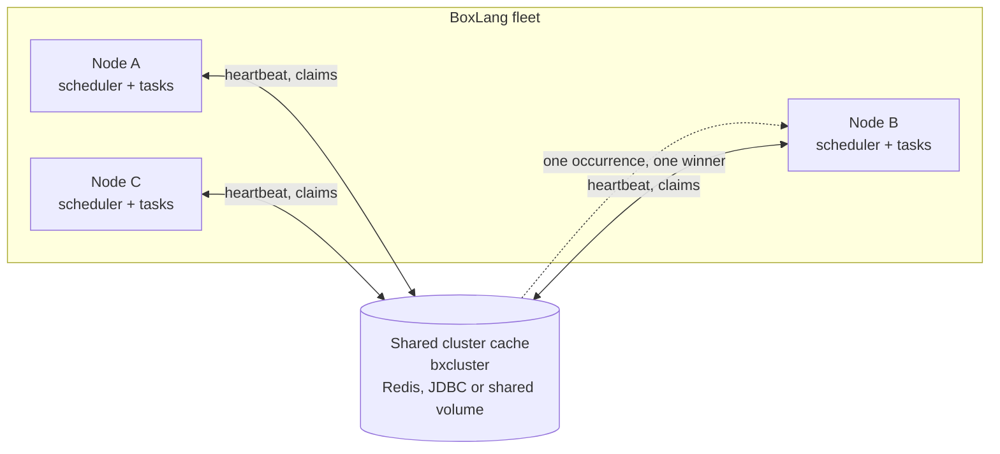
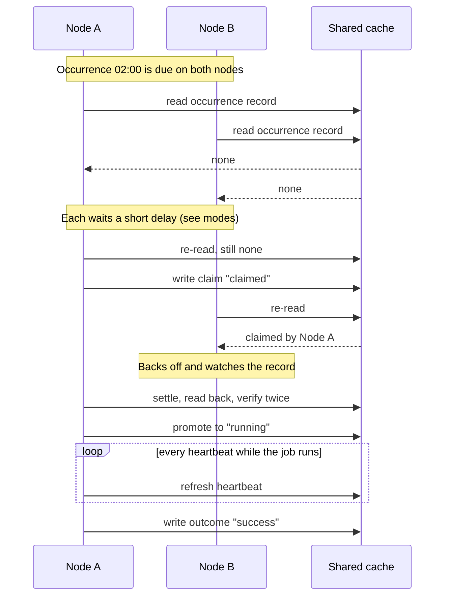
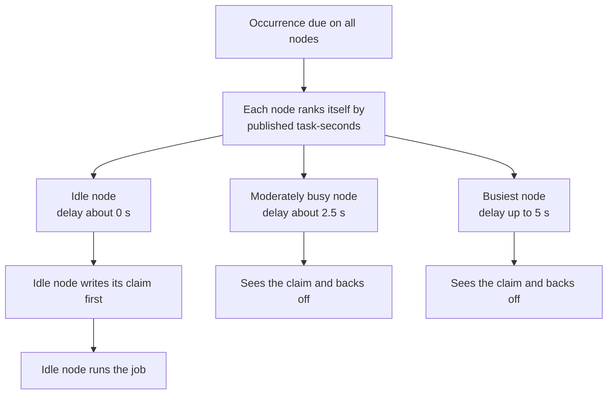
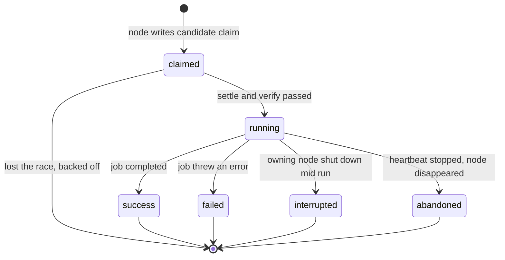
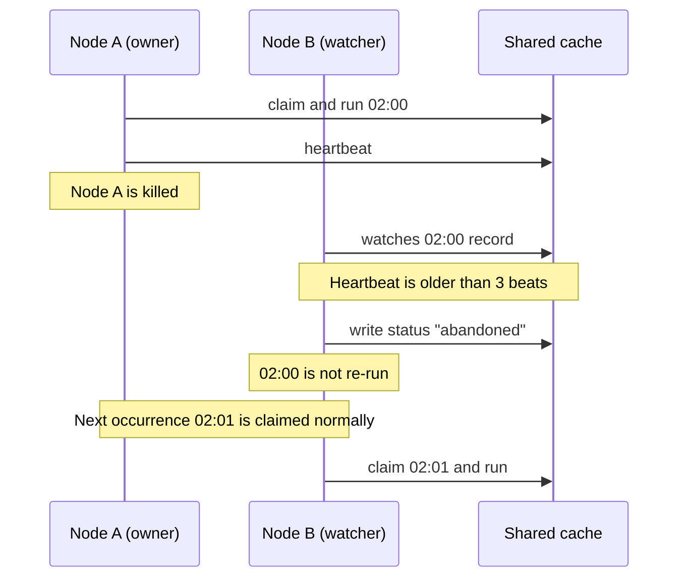

# Clustered Scheduled Tasks


**New in BoxLang 1.20.0.** Clustered scheduled tasks are the first feature built on the new BoxLang **cluster service**.


When you deploy the same codebase, and therefore the same schedulers and tasks, to every node of a fleet, every node runs every task. A nightly report scheduled for `02:00` runs once **per node**. A clustered task fixes that: each occurrence runs on **one node**, the work is shared out across the fleet, and every node keeps a record of what happened.

```js
// Fluent API
scheduler.task( "nightly-report" )
    .call( () => reportService.build() )
    .every( 1, "day" )
    .setCluster( true )
```

```js
// bx:schedule
bx:schedule action="create"
    task="nightly-report"
    url="https://example.com/report"
    interval="daily"
    cluster="true"
```

Tasks that do not opt in behave exactly as before. They add no cache traffic and need no configuration.


Clustering is not specific to scheduled tasks. The cluster service is a general foundation for coordinating BoxLang nodes through a shared cache. Scheduled tasks are its first consumer. See [Beyond Scheduled Tasks](#-beyond-scheduled-tasks).


## 🚀 Quick Start

### 1. Give every node a shared cache

Define a cache that every node can see. It must be backed by a store shared by the whole fleet: a distributed provider such as Redis, a JDBC store, or a `FileSystemStore` on a shared volume. The default name is `bxcluster`.

```json
{
    "caches": {
        "bxcluster": {
            "provider": "Redis",
            "properties": {
                "host": "redis.internal.example.com",
                "port": "6379",
                "keyprefix": "boxlang-cluster"
            }
        }
    }
}
```


The bundled `default` cache is local to each JVM. Pointing the cluster at it will not fail, but nodes will never see each other.


### 2. Enable clustering on every node

```json
{
    "cluster": {
        "enabled": true,
        "cacheName": "bxcluster",
        "heartbeatSeconds": 5
    },
    "scheduler": {
        "clusterMode": "balanced"
    }
}
```

### 3. Choose which tasks cluster

Tasks with no `cluster` flag follow `scheduler.clusterTasks`, which defaults to `true` on a clustered node. Be explicit with `setCluster( true )`, the `onOneServer()` alias, or `cluster="true"` on `bx:schedule`, and use `false` to run on every node. Every node registers the exact same scheduler unchanged.

```js
class {

    function configure() {
        scheduler.task( "nightly-report" )
            .call( () => createObject( "ReportService" ).build() )
            .everyDayAt( "02:00" )
            .setCluster( true )

        // Needs to run on every node, for example to warm a local cache
        scheduler.task( "warm-local-cache" )
            .call( () => createObject( "CacheWarmer" ).run() )
            .every( 10, "minutes" )
            .setCluster( false )
    }

}
```

## 🧭 How It Works

Each node runs its own scheduler and its own timers. Nothing is elected and no node is special. When an occurrence is due, every node **tries to claim it** in the shared cache. One claim wins and that node runs the job. The others see the claim and wait for the next occurrence.



The shared cache holds three kinds of state:

| State | Purpose |
|-------|---------|
| **Node records** | Which nodes are up, when each last checked in, and what each is running. |
| **Occurrence records** | One record per task occurrence: who claimed it and how it ended. |
| **Node attributes** | Open data a node publishes about itself. The scheduler publishes its recent load here. |

### The claim protocol

Claims are **per occurrence**. Every occurrence has its own key, so a busy or late node can never disturb an occurrence that is already running, and one occurrence can never overwrite another.



A node that loses a claim does not just walk away. It **watches** that occurrence. If the winner stops heartbeating, the watcher records the run as abandoned.


**Coordination is best effort, not a hard guarantee.** The cache API has no atomic create, so the protocol uses write, settle, read back and verify rounds instead. A contender that pauses between reading and writing can, in a very narrow window, overwrite a claim another node just started, and an occurrence can run twice. Duplicate detection logs it, but it cannot undo side effects. **Clustered jobs should be idempotent.**


## ⚖️ Cluster Modes

`scheduler.clusterMode` decides how nodes share occurrences out. Before claiming, each node waits a delay. The delay is what decides who wins.

| Mode | Delay before claiming | Use when |
|------|----------------------|----------|
| `eager` (default) | A random delay of up to 1 second. First writer wins. | Nodes are similar and you want the simplest behavior. |
| `balanced` | Nodes are ranked by published load. The least busy node waits 0, the busiest waits up to 5 seconds, evenly spaced between, plus up to 250 ms of jitter. | Work should flow to idle nodes. |

In `balanced` mode the load metric is **task-seconds**: a rolling 60 second window of how much task work a node has run or is running. Each node publishes it with its heartbeat, and every node ranks itself against the live peers it can see. With no peers visible, a node falls back to the eager delay, so a single node pays nothing for `balanced`.



### Minimum task period

A clustered task must have a period long enough for the claim protocol to finish. The minimum is **4 seconds** in `eager` mode and **8 seconds** in `balanced` mode. A shorter period is rejected at startup with a message that tells you what to change, rather than running late or twice.

## 🔄 Run Lifecycle

Every occurrence ends in exactly one recorded outcome.



| Status | Meaning |
|--------|---------|
| `claimed` | A node has written a candidate claim and is verifying it. Other nodes must respect it. |
| `running` | The claim is verified and the job is executing. The owner refreshes the heartbeat. |
| `success` | The job completed. |
| `failed` | The job threw an error. |
| `interrupted` | The owning node shut down cleanly while the job was running. Recorded by that node. |
| `abandoned` | The owning node disappeared without finishing. A peer recorded it. |


**An occurrence is never re-run.** `abandoned` and `interrupted` occurrences are never handed to another node. Only the *next* occurrence runs, on whichever node claims it. This is what prevents a job that already did half its work from doing it again.


### Failover

A node is considered gone after **three missed heartbeats**. With the default `heartbeatSeconds` of `5`, that is 15 seconds.



### Graceful shutdown

When a node shuts down, it stops accepting new work and waits for running work to finish.

| Setting | Default | Behavior |
|---------|---------|----------|
| `scheduler.shutdownGraceSeconds` | `15` | How long shutdown waits for in-flight runs before interrupting them. `0` skips the wait. |
| `scheduler.shutdownInterruptGraceSeconds` | `5` | How long to wait after interrupting before the executor is forced down. `0` skips the wait. |

With both set to `0`, shutdown stops runs immediately. A run that is cut short is recorded as `interrupted`, never as `success`, and is not handed to another node.

## 🔁 Overlap Policy

By default a clustered task does not start the next occurrence while the previous one is still running, on any node. Control this per task with `overlap`, or for the whole scheduler with `scheduler.taskOverlapPolicy`.

| Value | Behavior |
|-------|----------|
| `skip` (default) | The next occurrence is dropped while the previous one is live. Matches single node behavior. |
| `run` | Occurrences may run concurrently, on the same or different nodes. |

`overlap` governs **clustered** tasks. An unclustered task keeps its existing local dispatch.

## ⚙️ Configuration Reference

### `cluster` block

| Key | Type | Default | Description |
|-----|------|---------|-------------|
| `enabled` | `boolean` | `false` | Master switch for this node. When `false`, nothing else here is used, and a task marked clustered **refuses to start**. |
| `nodeId` | `string` | `null` | This node's identity. When `null`, BoxLang uses `{hostname}-{pid}`, unique per process. Set it when your platform gives you a stable pod or task name. |
| `name` | `string` | `"default"` | The cluster name. Nodes with the same name share work. Different names never see each other, so one cache can serve several independent clusters. |
| `cacheName` | `string` | `"bxcluster"` | The cache used for coordination. It must be backed by a store every node can see. |
| `heartbeatSeconds` | `integer` | `5` | How often a node rewrites its record. A node is gone after three missed beats. Must be greater than zero. |

### `scheduler` block

| Key | Type | Default | Description |
|-----|------|---------|-------------|
| `clusterMode` | `string` | `"eager"` | `eager` or `balanced`. See [Cluster Modes](#-cluster-modes). |
| `clusterTasks` | `boolean` | `true` | The default for tasks that state no `cluster` preference, and it only applies on a node where `cluster.enabled` is `true`. Set it to `false` to keep every task local on a clustered node unless it opts in. |
| `taskOverlapPolicy` | `string` | `"skip"` | `skip` or `run`. The default for tasks that do not set `overlap`. |
| `shutdownGraceSeconds` | `integer` | `15` | See [Graceful shutdown](#graceful-shutdown). |
| `shutdownInterruptGraceSeconds` | `integer` | `5` | See [Graceful shutdown](#graceful-shutdown). |

### Per task

| Setting | Fluent API | `bx:schedule` | `tasks.json` |
|---------|-----------|---------------|--------------|
| Participation | `setCluster( true \| false )`, `onOneServer()` | `cluster="true"` | `"cluster": true` |
| Overlap | `setOverlap( "skip" \| "run" )` | `overlap="skip"` | `"overlap": "skip"` |

`cluster` is a **tri-state**:

| Value | Result |
|-------|--------|
| not set | Inherits `scheduler.clusterTasks` (default `true`), and only on a node where `cluster.enabled` is `true`. On any other node the task runs locally, as before. |
| `true` | The task is clustered. |
| `false` | Opts this one task out, so it runs on every node. |

`cluster.enabled` says whether **this node is in a cluster**. `scheduler.clusterTasks` says whether **tasks cluster by default**. They are deliberately separate. An explicit `cluster` on a task always wins over `clusterTasks`.


`getServerFixation()` and `setServerFixation()` remain available as aliases for `getCluster()` and `setCluster()`. Tasks already using `onOneServer()`, or persisted with `"cluster": true` in `tasks.json`, keep working.


## 🗝️ Cache Key Layout

Everything lives under one root, `bxcluster:{cluster}:`, and each subsystem owns its own segment beneath it. The cluster name is the second segment of every key, so two clusters can share one physical cache and stay separate.

| Key | Owner | TTL | Purpose |
|-----|-------|-----|---------|
| `bxcluster:{cluster}:nodes` | cluster service | 6 x `heartbeatSeconds` | Member list. |
| `bxcluster:{cluster}:node:{nodeId}` | the node | 6 x `heartbeatSeconds` | Node record: heartbeat plus attributes. |
| `bxcluster:{cluster}:bxtasks:...:task:{task}` | scheduler | 24 hours | Advisory pointer to the in-flight occurrence, used only for `overlap=skip`. |
| `bxcluster:{cluster}:bxtasks:...:task:{task}:occurrence:{occurrence}` | scheduler | 24 hours | The claim record for one occurrence. |

```text
bxcluster:mycluster:nodes
bxcluster:mycluster:node:web01
bxcluster:mycluster:bxtasks:global:scheduler:ops:task:nightly-cleanup:occurrence:2026-11-17T01:00:00
bxcluster:mycluster:bxtasks:application:myApp:scheduler:ops:task:nightly-cleanup:occurrence:2026-11-17T01:00:00
```

* **One key per occurrence.** Two occurrences never contend for the same entry, so an older occurrence can never destroy a newer one's claim.
* **The 24 hour TTL is deliberate.** It keeps the last known state visible long enough for peers to read it, even for a monthly task. The run heartbeat refreshes it while a job runs.
* **Scope is `global` or `application:{name}`.** Schedulers from `boxlang.json` and `bx:schedule` tasks are `global`. Only schedulers declared in `Application.bx` have an application.
* **Names are case-insensitive**, and may contain `:`. Keep task and scheduler names short, since the JDBC store limits a key to 500 characters.
* **Each claim has a `claimId`.** A node name is reused across restarts, so the `claimId` lets a restarted node tell its own run from a dead predecessor's.
* **Node identity** defaults to `{hostname}-{pid}`. A configured `nodeId` is used exactly as given, so keep it unique per running process.

## 📊 Observing the Fleet

Every node writes a full track record of every clustered run, its own and its peers', to its `scheduler.log`. Peers watch each other on the heartbeat cadence, so a run is reported whether or not its task ever fires again.

```text
Task [nightly-report] occurrence [2026-11-21T02:00:00] INTERRUPTED on [web-3] - shutdown stopped the run, and it will not be re-run
Task [nightly-report] occurrence [2026-11-22T02:00:00] ABANDONED by [web-2] - its heartbeat stopped, and it will not be re-run
```

Use `getStats()` on a task to see `inetHost` and `localIp`, which tell you which node ran it.

## 🔌 Beyond Scheduled Tasks

The cluster service is deliberately separate from the scheduler. It owns **membership and node records** and never makes decisions: no leader election and no claim arbitration. Each consumer supplies its own policy. Scheduled tasks are one consumer, and the same foundation supports other clustered jobs such as cache invalidation, distributed locking or per node health aggregation.

| Capability | Description |
|------------|-------------|
| Node records | Each node rewrites a record in the shared cache on every heartbeat. |
| Attributes | An open struct on each node record. Any contributor can add keys, and the contributor owns their meaning. The scheduler publishes `scheduler.taskSeconds` here. |
| Peer snapshot | A debounced, lazily refreshed view of the other live nodes and their attributes. |
| Cluster report | A diagnostic view of the node id, cluster name, cache, mode and known nodes. |

Two interception points let your own code take part:

| Event | Purpose |
|-------|---------|
| `onClusterNodeAttributes` | Fired when contributors should add their data to this node's attributes. |
| `onClusterTaskRunReported` | Fired when a peer's run is reported finished, failed or abandoned. |

## ⚠️ Migrating from Server Fixation

Clustered tasks replace the lock based server fixation introduced in 1.18.0.

| Change | Detail |
|--------|--------|
| **Breaking: clustering must be on** | A task marked clustered now refuses to start on a node where `cluster.enabled` is `false`. Before, it silently ran on every node. |
| **Shared cache moves** | Coordination uses `cluster.cacheName`. `scheduler.cacheName` is deprecated but still honored as an upgrade bridge. The old `"default"` value is ignored, so upgrading does not switch clustering on. |
| **Config block** | `scheduler.cluster` is a deprecated fallback for the new top level `cluster` block. |
| **Failover semantics** | A node that crashes mid run no longer lets a survivor take over the same run. The occurrence is `abandoned` and the next one runs normally. |

## 🧰 Troubleshooting

| Symptom | Likely cause |
|---------|--------------|
| Task refuses to start with a "clustering is not enabled" error | The task has `cluster=true` but `cluster.enabled` is `false` on this node. |
| Task rejected at startup with a period error | The period is below the 4 second (`eager`) or 8 second (`balanced`) floor. Raise it, or set `cluster=false`. |
| Every node still runs the task | The task has `cluster=false`, `cluster.enabled` is `false` on that node, or `cluster.cacheName` points at a cache local to each JVM. |
| Nodes never see each other | Different `cluster.name` values, or the cache is not backed by a shared store. |
| A job ran twice | The narrow claim race described above. Make the job idempotent and check `scheduler.log` for the duplicate warning. |
| A run shows `abandoned` | The owning node stopped heartbeating for three beats. Check that node for a crash or a network partition. |

## 🔗 Related

* [Scheduled Tasks](scheduled-tasks.md)
* [Schedule Component](scheduling-component.md)
* [Scheduler Configuration](../../getting-started/configuration/scheduler.md)
* [Cluster Configuration](../../getting-started/configuration/cluster.md)
* [Caching](../caching/README.md)
* [BoxLang 1.20.0 Release Notes](../../readme/release-history/1.20.0.md)
