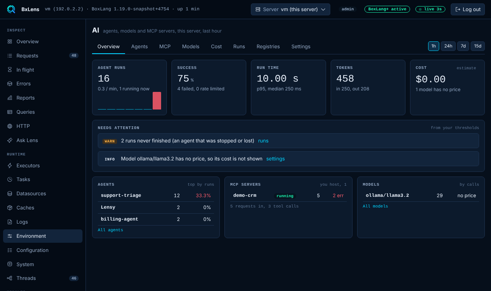
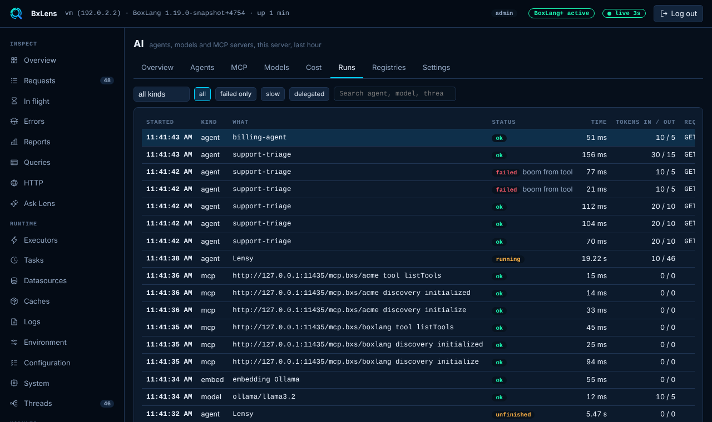

# AI and MCP observability

AI observability has two sides, and BoxLang covers both:

1. **Watching the AI you build.** What do my agents, models and tools do, and what do they cost?
2. **AI watching your runtime.** Can an AI assistant inspect a live BoxLang server and help with an incident?

| | Watching your agents | AI watching BoxLang |
| --- | --- | --- |
| **Tool** | BxLens AI page and BoxLang AI middleware | [BxMCP](../modularity/bx-mcp/README.md) |
| **Who looks** | You, in the BxLens console | An AI client, over MCP |
| **What it is about** | The agents, models and MCP servers you build with `bx-ai` | The BoxLang runtime itself |
| **License** | BoxLang+ for the full page | Free, needs `bx-ai` |

## 🤖 Watching the agents you build

### BxLens AI observability

The **AI** page of the BxLens console shows what the agents, models and MCP servers of `bx-ai` are doing on a server. It listens to the events of BoxLang AI, so there is no code change.

* **Runs and traces.** Open any run to see its model calls, tool calls and MCP calls, step by step. Filter by failed, slow or delegated.
* **Cost.** Tokens and an estimated cost for each agent and model, from a price table that you add.
* **Agent composition.** A diagram of how an agent is made: model, instructions, memory, skills, tools, sub-agents and middleware, each with how it performs.
* **MCP servers you host.** Requests, tool calls, failures, rejected callers and rate limits.
* **What needs attention.** Failed runs and rate limit hits are flagged.


The AI page is off until an admin turns it on. The full page is a BoxLang+ feature. Without a license it shows a few counters for the last hour. Cost is an estimate from your own price table.


<figure><figcaption>
The AI overview: runs, success, run time, tokens and cost
</figcaption></figure>

<figure><figcaption>
The trace of one run, step by step
</figcaption></figure>

### BoxLang AI middleware

When you build an agent, BoxLang AI includes middleware for an audit trail: `LoggingMiddleware` and `FlightRecorderMiddleware`. See [Governance and security](../../boxlang-ai/governance-and-security.md) in the BoxLang AI section.

## 🛰️ AI watching your runtime

[BxMCP](../modularity/bx-mcp/README.md) (`bx-mcp`) is a Model Context Protocol server for BoxLang. It lets an MCP capable client, such as an AI coding assistant or a monitoring tool, inspect and operate a live runtime over HTTP.

| Area | What the client can ask |
| --- | --- |
| Runtime introspection | BoxLang version, configuration, BIFs, components and services |
| JVM diagnostics | Memory, threads, CPU, garbage collection, hot threads and deadlocks |
| Data layer | Cache analytics, datasource pool metrics and slow SQL |
| HTTP and web | Outgoing call statistics, slow requests and per-route metrics |
| Operations | Executors, schedulers, modules, logging and file watchers |
| Health reports | One snapshot across all subsystems, with scoring and recommendations |
| Incident response | Triage, error spike and post-incident review workflows |

Access is controlled per token, with tool filtering, IP allowlisting and a tool allow list or block list.


BxMCP is free of charge but proprietary, and it requires the `bx-ai` module. No BoxLang+ subscription is required.



[operations-and-monitoring.md](../modularity/bx-mcp/operations-and-monitoring.md)



[incident-response.md](../modularity/bx-mcp/incident-response.md)



[security-and-access-control.md](../modularity/bx-mcp/security-and-access-control.md)


## 🤝 Use them together

An AI assistant that reads your runtime through BxMCP is itself an agent. If it runs on `bx-ai`, you can watch it on the BxLens AI page: its runs, its tool calls, its cost and the MCP server it calls. One tool shows what the assistant sees, and the other shows what the assistant does.

## 🔗 Related


[README.md](../../boxlang-ai/README.md)



[mcp.md](../../boxlang-ai/mcp.md)



[bxlens.md](bxlens.md)

