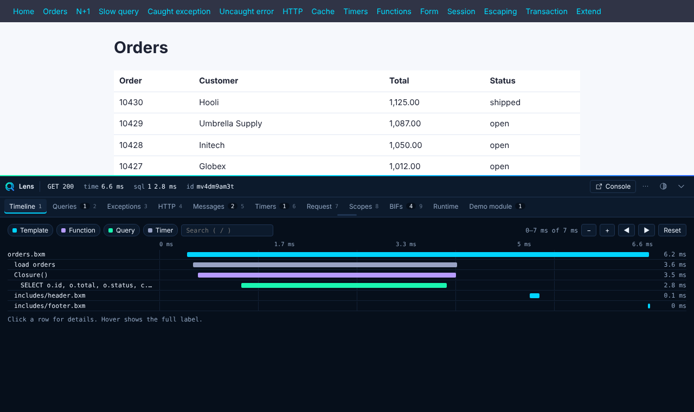
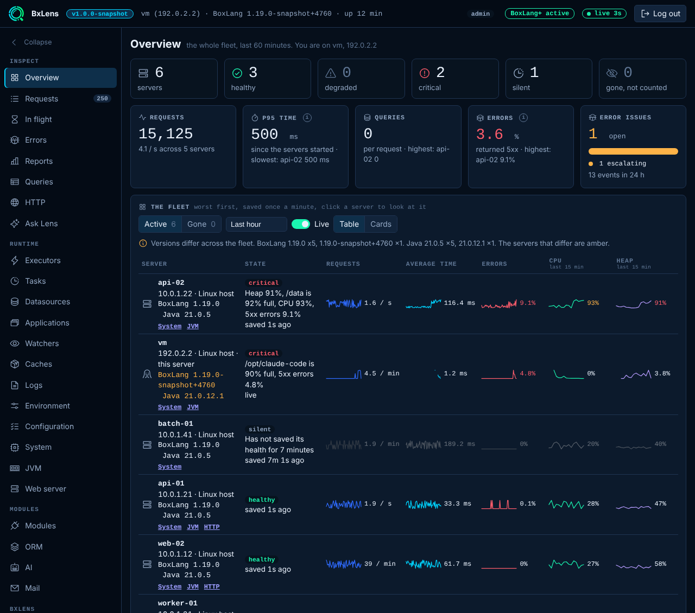
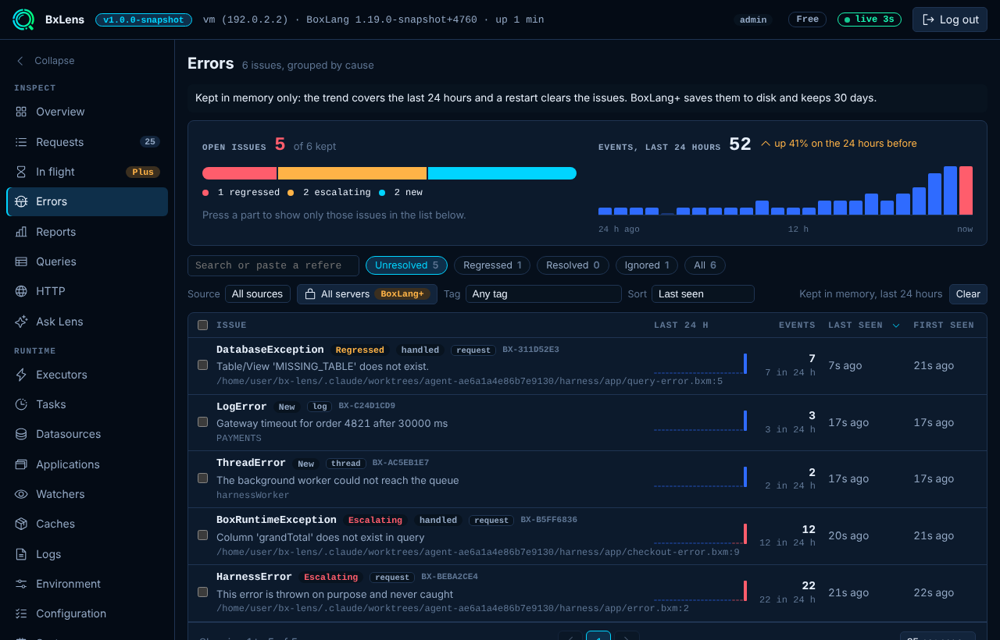
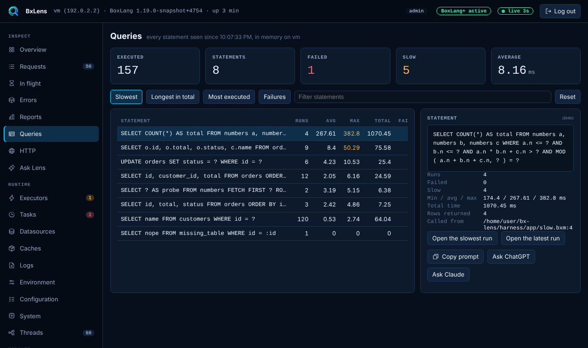
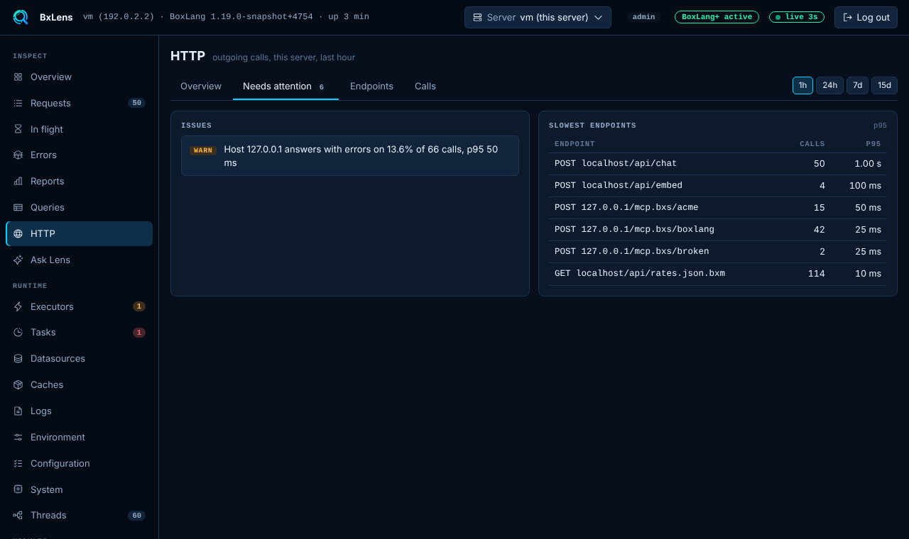
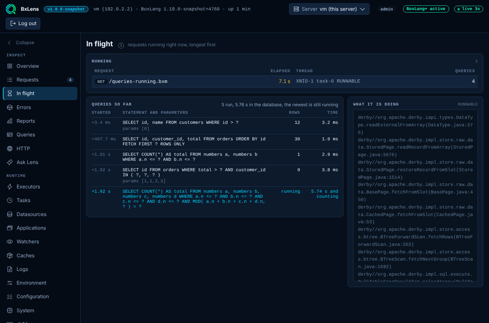
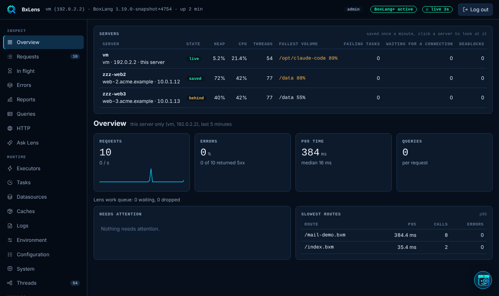
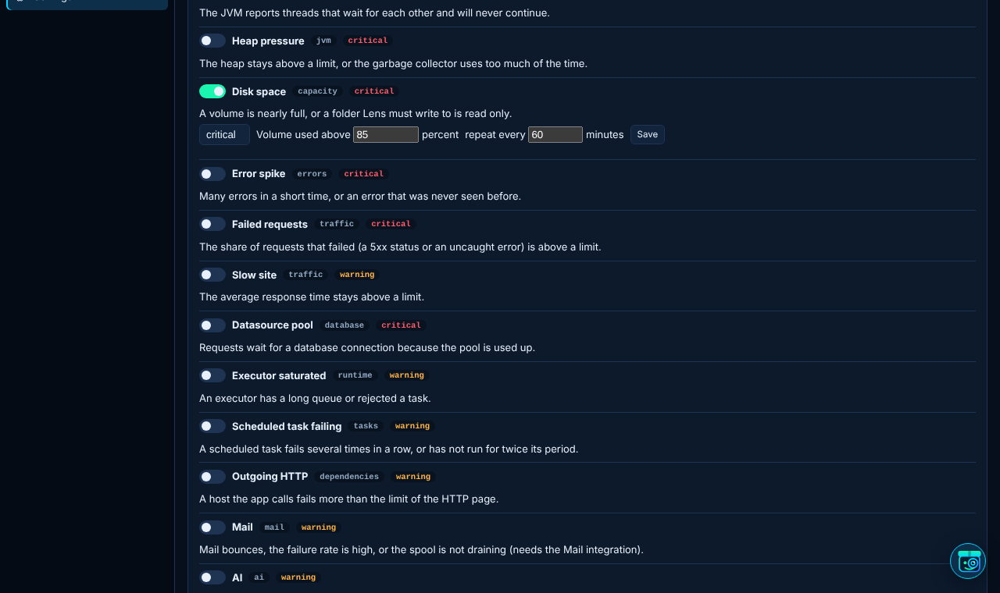
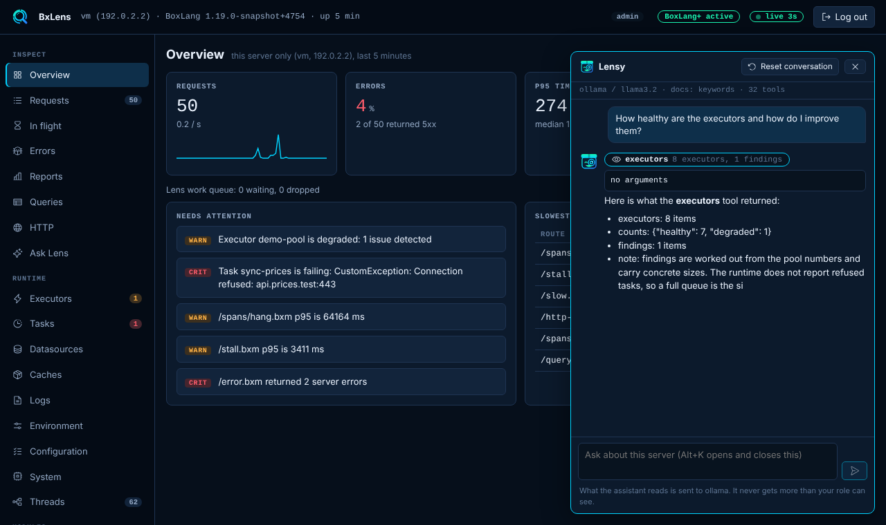
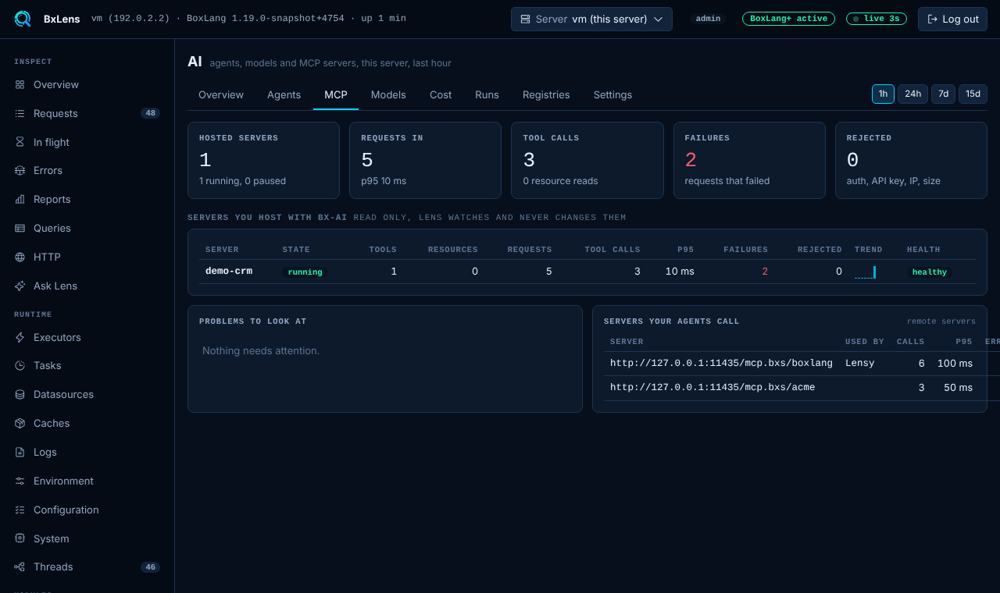

# Gallery and videos

## 🎬 The trailer



More trailers and nine narrated walkthroughs of the bar, the console, AI observability, mail, servers, alerts and ColdBox are on the BxLens site: see the [gallery](https://bxlens.boxlang.io/gallery/) and the [walkthroughs](https://bxlens.boxlang.io/walkthroughs/).

## 🪟 The bar

<figure><figcaption>
The bar on a page: a waterfall of templates, queries and HTTP calls for one request
</figcaption></figure>

## 🖥️ The console

<figure><figcaption>
Overview: the health of the server at a glance
</figcaption></figure>

<figure><figcaption>
Errors, grouped into issues you can resolve or ignore
</figcaption></figure>

<figure><figcaption>
Queries: the slowest and the most repeated statements
</figcaption></figure>

<figure><figcaption>
Outgoing HTTP calls by host and endpoint
</figcaption></figure>

<figure><figcaption>
In flight: the requests running right now (BoxLang+)
</figcaption></figure>

## 🌐 Many servers, alerts and the assistant

<figure><figcaption>
The whole fleet in one table (BoxLang+)
</figcaption></figure>

<figure><figcaption>
Alert rules, sent by email, Slack, Teams, Telegram or webhook (BoxLang+)
</figcaption></figure>

<figure><figcaption>
Lensy answers in plain words and asks before it changes anything (BoxLang+)
</figcaption></figure>

## 🤖 AI observability

<figure><figcaption>
Runs, success, tokens and cost for your agents (BoxLang+)
</figcaption></figure>

<figure><figcaption>
The trace of one run, step by step
</figcaption></figure>

<figure><figcaption>
The MCP servers you host, with requests, failures and rate limits
</figcaption></figure>


[README.md](README.md)

