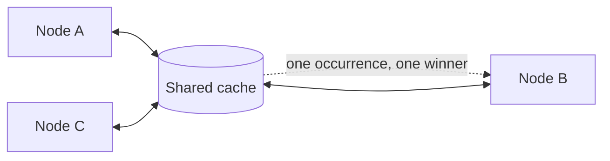

# 1.20.x

<!-- TODO: confirm before release. Scope below reflects the `[Unreleased]` section of the BoxLang changelog.md and BL-2809 as of November 19, 2026. Add the release date, the Jira "Current" list, the Release Snapshot counts and the Release Notes lists on release day. -->

**BoxLang 1.20.0** continues our development mantra: **BoxLang is the AI-native software productivity platform for building, modernizing and running applications, with developers and AI agents working together.** This release makes scheduled tasks **cluster-aware**, so a task runs once per occurrence anywhere in your fleet. It also lets `systemExecute()` stream output and be cancelled without dropping to Java's `ProcessBuilder`, makes `Struct.putIfAbsent` atomic, fixes row loss in very large queries, and stops cron scheduled tasks from silently skipping a day when a tick runs late.


## 🌐 NEW: Clustered Scheduled Tasks

**Run once, anywhere in the fleet.** Mark a task with `setCluster( true )` or `cluster="true"` and each occurrence runs on one node, shared out by load, with failover and a full run history. Read [Clustered Scheduled Tasks](../../boxlang-framework/asynchronous-programming/clustered-scheduled-tasks.md).



## ⏯️ NEW: Live Output and Cancellation for `systemExecute()`

**Run interactive CLI jobs straight from BoxLang.** Three new optional arguments let you see output as it arrives, stop a running process on demand, and choose whether stderr is merged into stdout. Read [Live Output and Cancellation](../../boxlang-framework/os-integration.md#live-output-and-cancellation).


## 🚀 Major Highlights

### 🌐 Clustered Scheduled Tasks

When you deploy the same schedulers to every node, every node runs every task. **Clustered scheduled tasks** fix that. Each occurrence of a clustered task runs on **one node**, work is shared across the fleet, and every node keeps a record of what happened. It is the first feature built on the new BoxLang **cluster service**, which coordinates nodes through a shared cache and is designed for other clustered jobs too.

```js
// Fluent API
scheduler.task( "nightly-report" ).setCluster( true ).every( 1, "day" )

// bx:schedule
bx:schedule action="create" task="nightly-report" cluster="true" interval="daily" url="https://example.com/report"
```

```json
{
    "cluster": {
        "enabled": true,
        "cacheName": "bxcluster",
        "heartbeatSeconds": 5
    },
    "scheduler": {
        "clusterMode": "balanced"
    }
}
```



* **One node per occurrence.** Every node tries to claim the occurrence in the shared cache. One wins and runs it. Claims are per occurrence, so a late or busy node cannot disturb a run in progress.
* **Shared out by load.** `scheduler.clusterMode` is `eager` (random short delay, the default) or `balanced` (nodes rank each other by published load, so an idle node takes the job).
* **Failover without double runs.** A winner heartbeats while the job runs. If its node disappears, a peer records the run as `abandoned`. A clean shutdown records `interrupted`. Neither is ever re-run, and the next occurrence runs normally.
* **Graceful shutdown.** A node stops accepting new work and waits for running work, controlled by `scheduler.shutdownGraceSeconds` and `scheduler.shutdownInterruptGraceSeconds`. A cut short job is never recorded as a success.
* **Full run history.** Every node logs every clustered run, its own and its peers', to `scheduler.log`.
* **Opt in per task.** `cluster` is a tri-state. Unclustered tasks behave exactly as before, with no extra cache traffic. Tasks using `onOneServer()` or `"cluster": true` in `tasks.json` keep working, and `getServerFixation()` remains an alias.
* **Best effort.** The cache offers no atomic create, so in a very narrow window an occurrence can run twice. Make clustered jobs idempotent.

Backing stores for the shared cache include Redis, a JDBC store, or a `FileSystemStore` on a shared volume. Read the full guide in [Clustered Scheduled Tasks](../../boxlang-framework/asynchronous-programming/clustered-scheduled-tasks.md) and the [Cluster configuration](../../getting-started/configuration/cluster.md).

### ⏯️ `systemExecute()`: `onLine`, `isCancelled` and `mergeErrors` (BL-2809)

[`systemExecute()`](../../boxlang-language/reference/built-in-functions/system/SystemExecute.md) already handled timeouts, working directories, environment overrides and output capture. It now also covers the interactive case.

| Argument | Behavior |
|----------|----------|
| `onLine( line, stream )` | Called as each output line arrives, before the process exits. `stream` is `"stdout"` or `"stderr"`. Runs on the calling thread. Output is still captured in the result. |
| `isCancelled()` | Polled while the process runs. When it returns `true`, the process and its children are terminated, the streams are cleaned up, and the output captured so far is returned with `cancelled = true`. Distinct from a timeout and from a nonzero exit. |
| `mergeErrors = false` | When `true`, stderr is combined into stdout for one live log. When `false` (the default), the streams stay separate so you can parse stdout as JSON. |

```js
start = getTickCount()

result = systemExecute(
    name        = "npm",
    arguments   = [ "run", "build" ],
    mergeErrors = true,
    onLine      = ( line ) => println( line ),
    isCancelled = () => getTickCount() - start > 60000
)

if ( result.cancelled ) {
    println( "Build cancelled" )
}
```

* **Cancellation and timeout stay separate.** A cancelled call returns `cancelled = true`, `terminated = true` and `timeout = false`, plus the exit code of the killed process. A timeout still sets `timeout = true`.
* **Works on any process.** Cancellation and timeout behave the same for a process that is silent, stalls mid-line, or never stops printing, and both streams are drained without deadlocking.
* **Still synchronous.** There is no async mode and no process handle. Run it in a thread or a background job when you need it off the request.
* **Redirected streams.** A stream sent to a file with `output` or `error` gets no callbacks. `mergeErrors = true` together with `error` throws.
* **Nothing changes unless you opt in.** Existing calls behave the same. The result struct gains a `cancelled` key, which is `false` unless a cancellation happened.

See the full reference in [OS Integration](../../boxlang-framework/os-integration.md#live-output-and-cancellation).

## ✨ New Features and Improvements

### Language and Runtime

* [**BL-2809**](https://ortussolutions.atlassian.net/browse/BL-2809) - `systemExecute()` gains `onLine`, `isCancelled` and `mergeErrors`, and the result gains `cancelled`.
* [**BL-2808**](https://ortussolutions.atlassian.net/browse/BL-2808) - `Struct.putIfAbsent` is now atomic and follows the `Map` contract. It returns the existing value when the key is present (it used to return `null`) and `null` only when the key was absent. Change listeners fire only for the call that inserts. `structInsert( struct, key, value, false )` now claims the key atomically, so concurrent callers can no longer both succeed. Java integrators get `IStruct.tryPutIfAbsent`, and `StructMapWrapper.putIfAbsent` now returns the existing value too.

### Scheduled Tasks

* **Clustered scheduled tasks.** New top level `cluster` block in `boxlang.json` (`enabled`, `nodeId`, `name`, `cacheName`, `heartbeatSeconds`), new `scheduler.clusterMode`, `scheduler.taskOverlapPolicy`, `scheduler.shutdownGraceSeconds` and `scheduler.shutdownInterruptGraceSeconds` settings, `setCluster()` and `setOverlap()` on tasks, and `cluster` and `overlap` on `bx:schedule`.
* **Clustered tasks with too short a period are rejected at startup.** The minimum is 4 seconds in `eager` mode and 8 seconds in `balanced` mode.
* **Cron ticks that run late no longer skip a day.** A tick that is queued behind other tasks, for example on a saturated scheduler executor, now fires if a cron time was due since the previous check. It runs late rather than never, and logs a warning with a thread-count hint when the executor is saturated.
* **Constraints use the due time.** Scheduled task constraints (weekdays, day of the week or month, first or last business day, time windows, start and end dates) are now judged against the time a tick was due, so a late tick is not skipped by crossing midnight.
* **Scheduler executors are sized from your config.** They are sized from the `threads` of the executor named by `scheduler.executor` in `boxlang.json`. They were always 10. The documented `threads` property of `executors` entries is now honored.
* **`bx:schedule` with `cronTime` and `exclude`.** `exclude` no longer replaces the cron gate when a task sets both.

## 🐛 Notable Bug Fixes

* [**BL-2717**](https://ortussolutions.atlassian.net/browse/BL-2717) - Queries with more than 1,048,576 rows no longer lose rows or throw a `NullPointerException` when read. `ChunkedArrayList.trimToSize()` released top-level chunks that still held live rows once a list had grown past its first layer of chunks, which chunked query storage reaches at 1,048,576 rows with the default chunk size.

## ⚡ Migration Notes

* **Clustered tasks require clustering to be enabled (breaking).** A task marked clustered, with `onOneServer()`, `cluster="true"` or `"cluster": true`, now refuses to start on a node where `cluster.enabled` is `false`. Before, it silently ran on every node. Enable the `cluster` block, or set the task's `cluster` to `false`.
* **Failover semantics changed.** Server fixation used a lock that expired so a surviving node could pick up a crashed node's run. Clustered tasks never re-run an occurrence. A crashed run is `abandoned` and the next occurrence runs normally.
* **`scheduler.cacheName` is deprecated.** Use `cluster.cacheName`. The old value is still honored as an upgrade bridge, except the legacy `"default"` value, which is ignored so upgrading does not switch clustering on. `scheduler.cluster` is a deprecated fallback for the new `cluster` block.
* **Tasks inherit `cluster.enabled`.** Once the cluster is enabled, every task that does not set `cluster` is clustered. Set `cluster` to `false` on tasks that must run on every node.
* **`Struct.putIfAbsent` return value (BL-2808).** It now returns the existing value when the key is already present. Before, it returned `null` in that case. Code that treated a non-`null` return as "I inserted" must now check for `null` instead.
* **Scheduler executor size.** Scheduler executors now follow the `threads` of the executor named by `scheduler.executor`. If you relied on the fixed size of 10, set `threads` explicitly.
* **`systemExecute()` result.** The struct has a new `cancelled` key. Code that loops over the keys will see it.

----

## 🎶 Release Notes

<!-- TODO: fill in from Jira on release day. -->
